# Audit de Sécurité — OWASP Juice Shop
### Détection, exploitation et remédiation de vulnérabilités web réelles


Audit de sécurité complet de **OWASP Juice Shop**, l'application web officiellement vulnérable de l'OWASP, menant à l'identification, l'exploitation contrôlée et la remédiation de 5 catégories de failles réelles : injection SQL, XSS, CSRF, exposition d'API et force brute.

> Auteurs : **Wissal MOKDAD** et **Hafssa AZARG** — Encadrant : Prof. Mohammed CHINY — EMSI, 2025

---

## Table des matières
1. [Contexte](#contexte)
2. [Cible et architecture](#cible-et-architecture)
3. [Méthodologie](#méthodologie)
4. [Déploiement](#déploiement)
5. [Vulnérabilités identifiées](#vulnérabilités-identifiées)
6. [Étude de cas : exploitation CSRF](#étude-de-cas--exploitation-csrf)
7. [Synthèse des risques](#synthèse-des-risques)
8. [Solutions proposées](#solutions-proposées)
9. [Bonnes pratiques](#bonnes-pratiques)
10. [Documentation](#documentation)

---

## Contexte

Les cyberattaques ciblant les applications web sont en croissance constante. L'**OWASP Top 10** reste la référence mondiale pour identifier les vulnérabilités les plus critiques (injection SQL, XSS, authentification défaillante). Cet audit démontre, sur une cible volontairement vulnérable, qu'une application à l'architecture moderne peut contenir des failles critiques exploitables rapidement, et propose des correctifs concrets pour chacune.

## Cible et architecture

**OWASP Juice Shop** simule une boutique e-commerce complète (catalogue, panier, authentification, commande) tout en embarquant intentionnellement plus de 100 vulnérabilités, à des fins de formation et de pentesting.

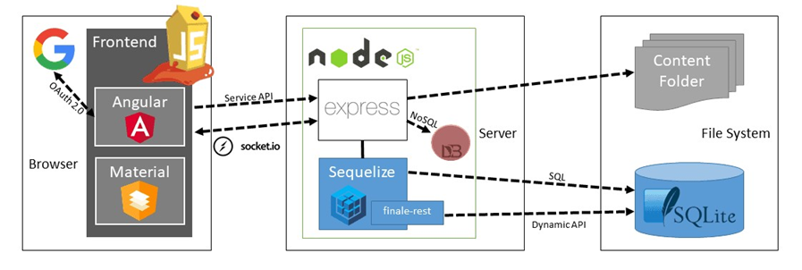

| Couche | Technologie |
|---|---|
| Frontend | Angular (Single Page Application) |
| Backend | Node.js + Express, API REST |
| Base de données | SQLite, via Sequelize |

## Méthodologie

Audit mené en 4 étapes structurées :

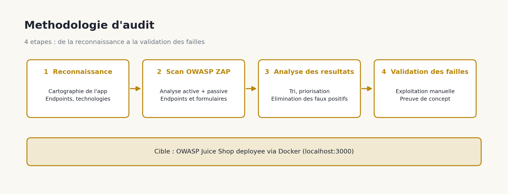

1. **Reconnaissance** : cartographie des pages, formulaires, endpoints API et technologies.
2. **Scan OWASP ZAP** : analyse automatisée active et passive de l'application.
3. **Analyse des résultats** : tri et priorisation des alertes, élimination des faux positifs.
4. **Validation des failles** : exploitation manuelle pour confirmer l'exploitabilité réelle et documenter les preuves de concept.

**Outils utilisés** : OWASP Juice Shop (cible), OWASP ZAP (scanner), Docker (déploiement isolé et reproductible), DevTools / Postman / scripts personnalisés (exploitation manuelle).

## Déploiement

L'application a été déployée via Docker en une seule commande :

```bash
docker run --rm -p 3000:3000 bkimminich/juice-shop
```

| Déploiement Docker | Catalogue accessible |
|:--:|:--:|
| 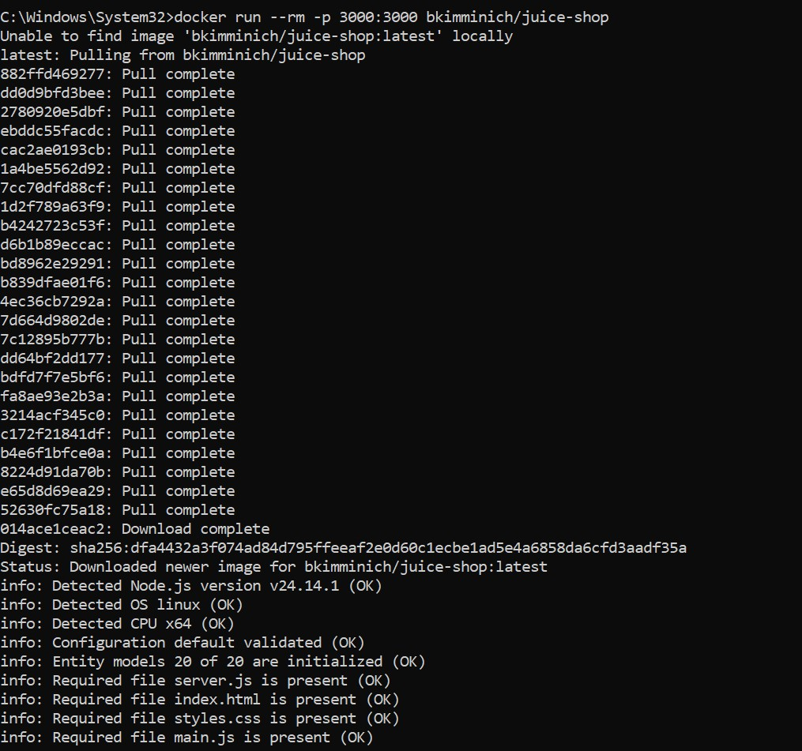 | 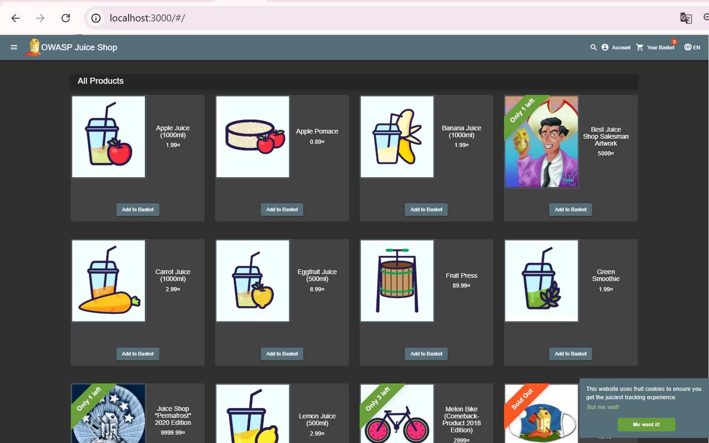 |

L'application est exposée sur `http://localhost:3000`. Fonctionnalités identifiées : authentification utilisateur, catalogue et recherche dynamique, panier, processus de commande, module de feedback, API REST interne — autant de points d'entrée testés durant l'audit.

## Vulnérabilités identifiées

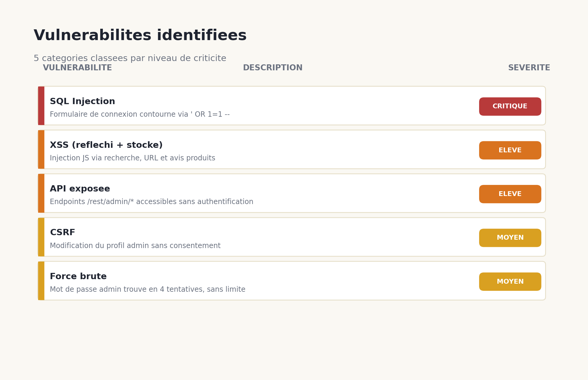

### SQL Injection — Critique
Le formulaire de connexion n'applique aucune validation : le payload `' OR 1=1 --` dans le champ email force la requête à retourner le premier compte de la base (l'administrateur), sans mot de passe.

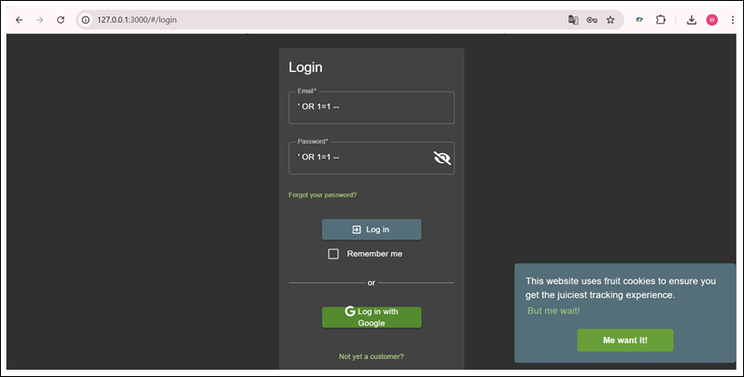

### Cross-Site Scripting (XSS) — Élevé
Trois vecteurs identifiés : barre de recherche (iframe), URL directe (phishing) et avis produits (XSS stocké, exécuté pour tous les visiteurs).

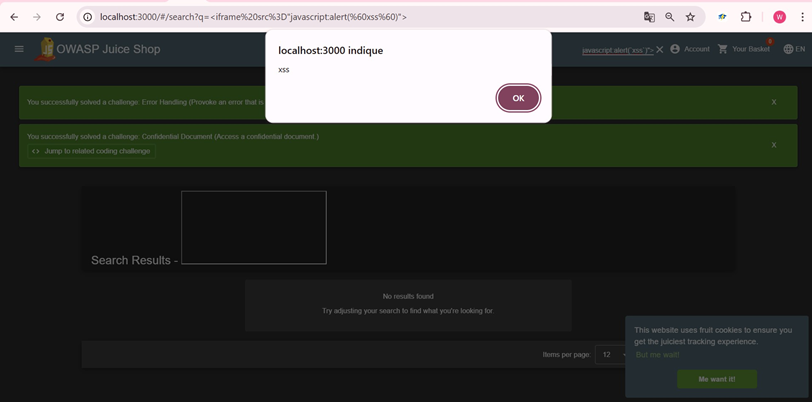

### API exposée — Élevé
Plusieurs endpoints REST (`/rest/admin/application-configuration`, `/api/Products`, `/rest/admin/application-version`) sont accessibles sans authentification et exposent configuration, prix internes et version exacte de l'application — une violation du principe du moindre privilège.

### CSRF — Moyen
Détaillé ci-dessous : modification du profil administrateur à son insu.

### Force brute — Moyen
Aucune limite de tentatives sur `/rest/user/login`. Mot de passe administrateur (`admin123`) trouvé en 4 tentatives, sans alerte ni blocage.

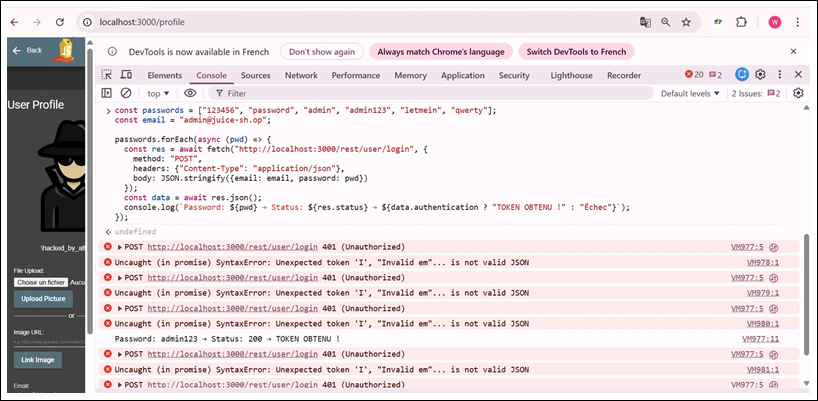

## Étude de cas : exploitation CSRF

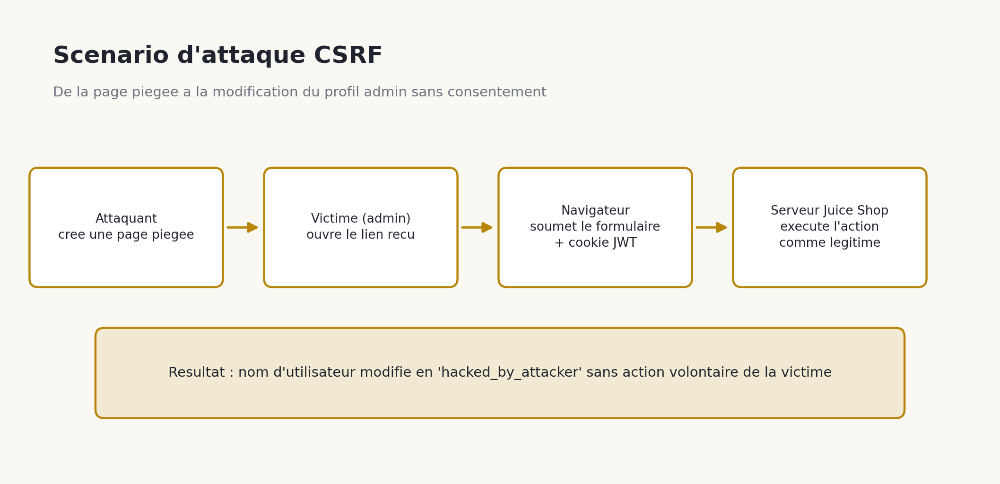

**Étape 1 — Requête vulnérable** : interception via DevTools (Network) : `POST /profile` sans token CSRF, cookie JWT envoyé automatiquement.

**Étape 2 — Analyse des headers** : aucun `X-CSRF-Token`, aucun attribut `SameSite=Strict` sur le cookie, aucune protection côté serveur.

**Étape 3 — Page piégée** :
```html
<form action="http://localhost:3000/profile" method="POST">
  <input type="hidden" name="username" value="hacked_by_attacker"/>
</form>
<script>document.forms[0].submit();</script>
```

**Étape 4 — Déroulement** : la victime, déjà authentifiée, ouvre le lien ; le formulaire se soumet automatiquement ; le navigateur ajoute le cookie JWT ; le serveur exécute l'action comme légitime.

**Étape 5 — Résultats** :

| Profil modifié sans consentement | Erreur serveur exposant la stack trace |
|:--:|:--:|
| 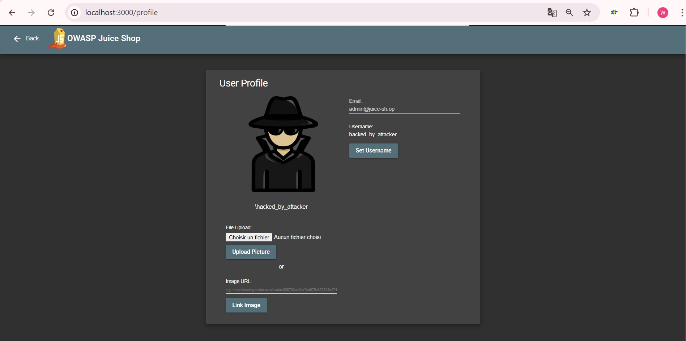 | 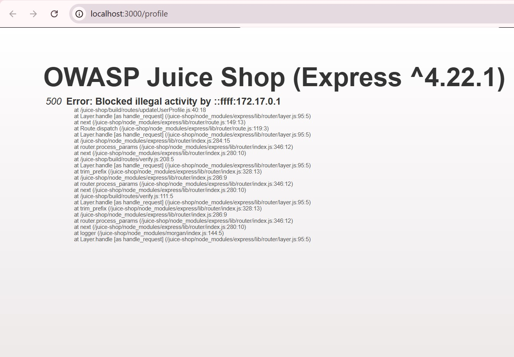 |

L'erreur 500 est elle-même une vulnérabilité additionnelle : elle révèle la version d'Express et l'architecture backend.

## Synthèse des risques

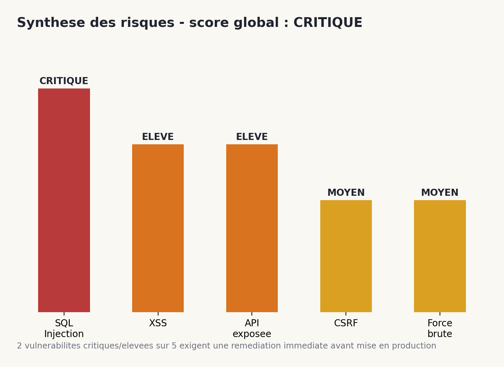

| Impact | Détail |
|---|---|
| Utilisateur | Vol de données personnelles, sessions compromises, perte de confiance |
| Entreprise | Atteinte à la réputation, pertes financières, non-conformité réglementaire (RGPD) |
| **Score global** | **CRITIQUE** — SQL Injection et API exposée nécessitent une remédiation immédiate avant tout environnement de production |

## Solutions proposées

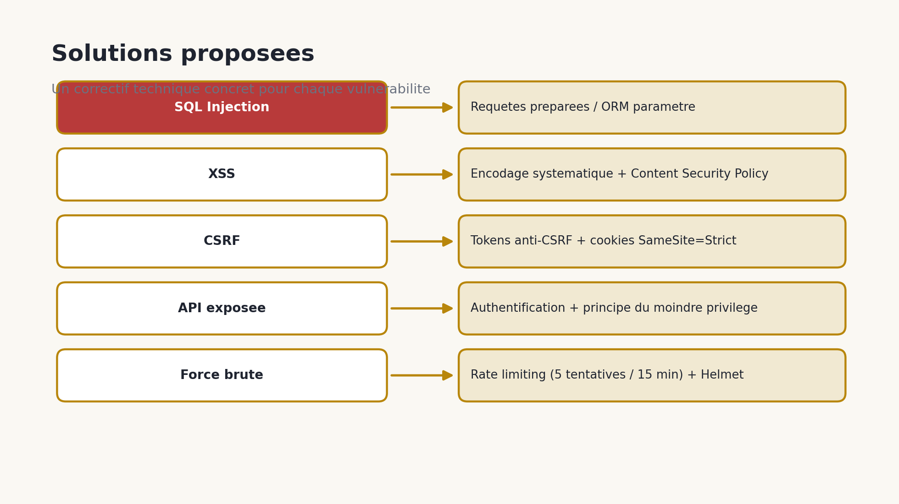

| Vulnérabilité | Correctif |
|---|---|
| SQL Injection | Requêtes préparées / paramétrées, ou ORM (Sequelize) |
| XSS | Encodage systématique des sorties, Content Security Policy stricte |
| CSRF | Tokens anti-CSRF + cookies `SameSite=Strict` |
| API exposée | Authentification obligatoire, principe du moindre privilège |
| Force brute | Rate limiting (`express-rate-limit`, 5 tentatives / 15 min) + Helmet |

## Bonnes pratiques

- **Validation serveur rigoureuse** : ne jamais faire confiance aux données client ; listes blanches plutôt que listes noires.
- **Headers HTTP sécurisés** : `Content-Security-Policy`, `X-Frame-Options`, `X-Content-Type-Options`.
- **Défense en profondeur** : plusieurs couches de protection pour limiter l'impact d'une faille unique.

## Documentation

- Présentation complète : [Télécharger la présentation PowerPoint](https://github.com/hafssa799/Cybersecurity-Portfolio/raw/main/OWASP-Juice-Shop-Audit/docs/Audit-Securite-OWASP-Juice-Shop-Presentation.pptx)
---

*Cet audit a été réalisé dans un cadre pédagogique, sur une application officiellement conçue pour l'entraînement à la sécurité (OWASP Juice Shop). Aucune des techniques présentées ne doit être appliquée sur un système sans autorisation explicite.*
