# DIRS Security Suite
### Device Integrity & Risk Scorer: static risk scoring for Android APKs


DIRS is a lightweight static-analysis tool that turns the metadata of an Android package (permissions, manifest flags, native libraries, signing scheme) into a **normalized 0-100 risk score** with findings mapped to **OWASP MASVS** and **NIST SP 800-124**.

The whole analysis runs **in the browser**: the APK is read with the File API and processed in memory, so no byte of the file is sent to a server. This makes the tool usable in air-gapped or regulated environments.

> Authors: **Wissal MOKDAD** and **Hafssa AZARG**, Cybersecurity Engineering Department

---

## Table of contents
1. [Why DIRS](#why-dirs)
2. [Screenshots](#screenshots)
3. [Architecture](#architecture)
4. [Analysis pipeline](#analysis-pipeline)
5. [Scoring model](#scoring-model)
6. [Worked example](#worked-example)
7. [Standards mapping](#standards-mapping)
8. [Getting started](#getting-started)
9. [Project structure](#project-structure)
10. [Limitations](#limitations)
11. [Roadmap](#roadmap)
12. [Documentation](#documentation)
13. [License](#license)

---

## Why DIRS

| Tool family | Strength | Gap DIRS targets |
|---|---|---|
| Signature scanners (VirusTotal, MobSF scan mode) | Known-malware detection | Binary safe/unsafe verdict, little help for custom or enterprise apps |
| Deep frameworks (Androguard, MobSF, Apktool) | Exhaustive technical output | Need expertise, slow for triage, often server-side |
| Cloud platforms | Managed analysis | Require uploading the APK to a third party |
| **DIRS** | **Fast, private, readable score** | **Triage only, no dynamic analysis** (see [Limitations](#limitations)) |

## Screenshots

| Audit Scanner | Dashboard |
|:--:|:--:|
| 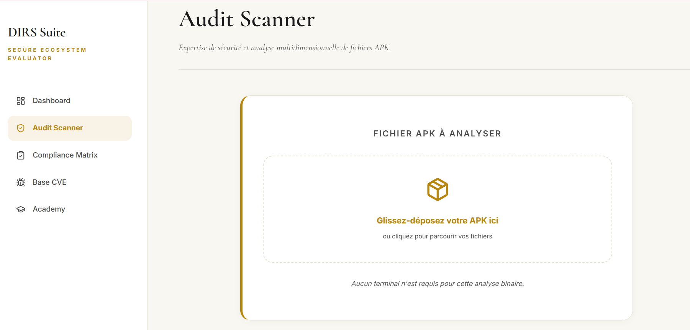 | 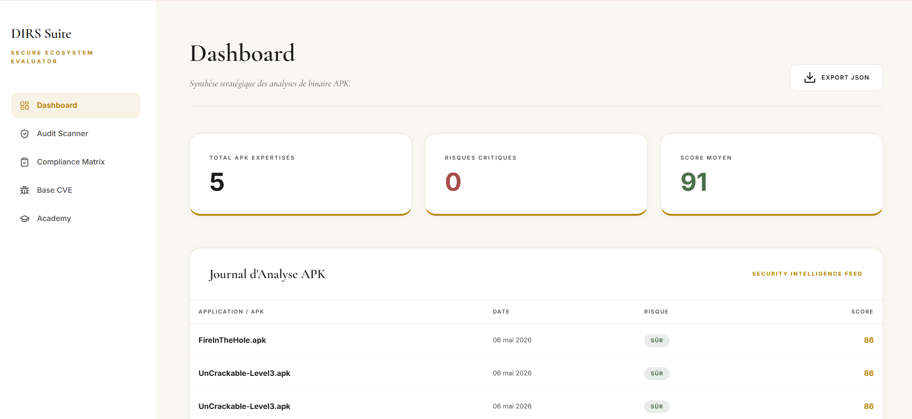 |
| Drag & drop an APK, then run the analysis | Global score, analysis history, JSON export |

| Compliance Matrix | CVE Explorer |
|:--:|:--:|
| 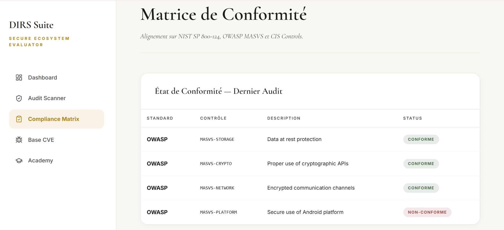 | 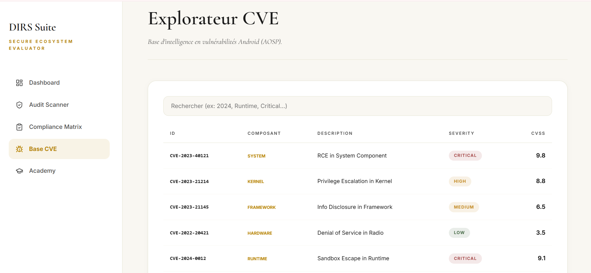 |
| Findings mapped to OWASP MASVS / NIST controls | Embedded, searchable Android CVE database |

| Security Academy |
|:--:|
| 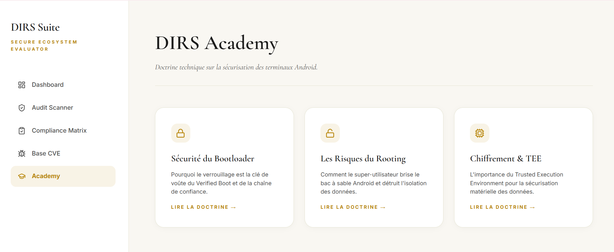 |
| Remediation guides and security concepts |

## Architecture

DIRS is a single-page application with three layers and no server component.

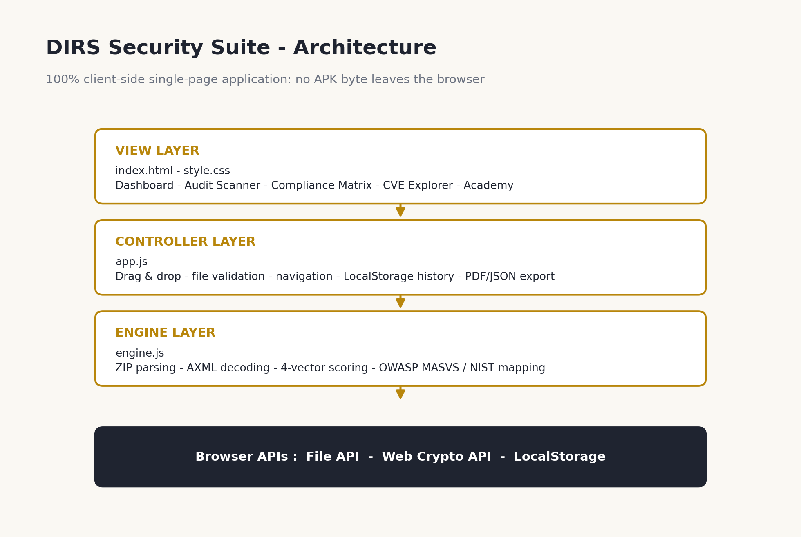

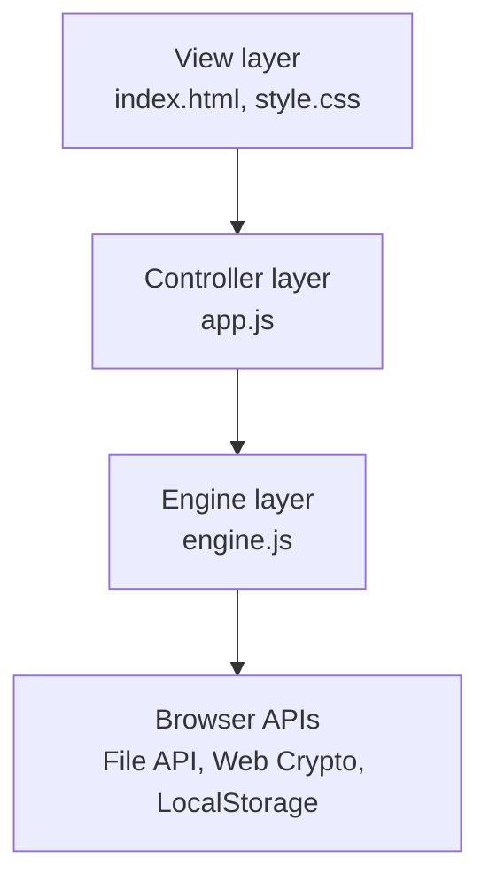

## Analysis pipeline

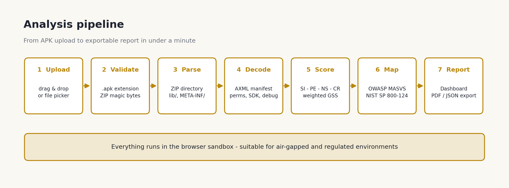

1. **Validate**: `.apk` extension and ZIP magic number (`PK\x03\x04`).
2. **Parse**: walk the ZIP directory for `AndroidManifest.xml`, `lib/*.so` and `META-INF/`.
3. **Decode**: custom lightweight AXML parser extracts permissions, `targetSdkVersion` and the `debuggable` flag.
4. **Score**: four independent vectors, then a weighted Global Security Score (GSS).
5. **Map** findings to MASVS and NIST controls, then **report** (dashboard, PDF/JSON export).

## Scoring model

Each vector starts at 100 and loses points for each risk indicator found.

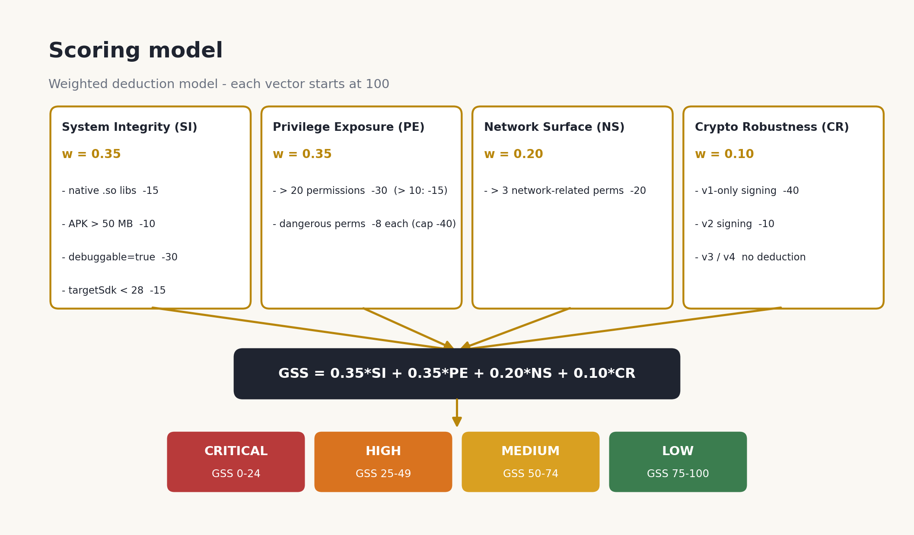

```
GSS = 0.35 * SI + 0.35 * PE + 0.20 * NS + 0.10 * CR
```

| GSS | Risk level |
|---|---|
| 75 - 100 | LOW |
| 50 - 74 | MEDIUM |
| 25 - 49 | HIGH |
| 0 - 24 | CRITICAL |

Weights are configurable in the engine configuration object, so the model can be adapted to other threat scenarios.

## Worked example

A hypothetical banking APK: 38.2 MB, 23 permissions (3 dangerous: `READ_SMS`, `CAMERA`, `ACCESS_FINE_LOCATION`), 2 native libraries, `targetSdkVersion` 33, v2 signing, not debuggable.

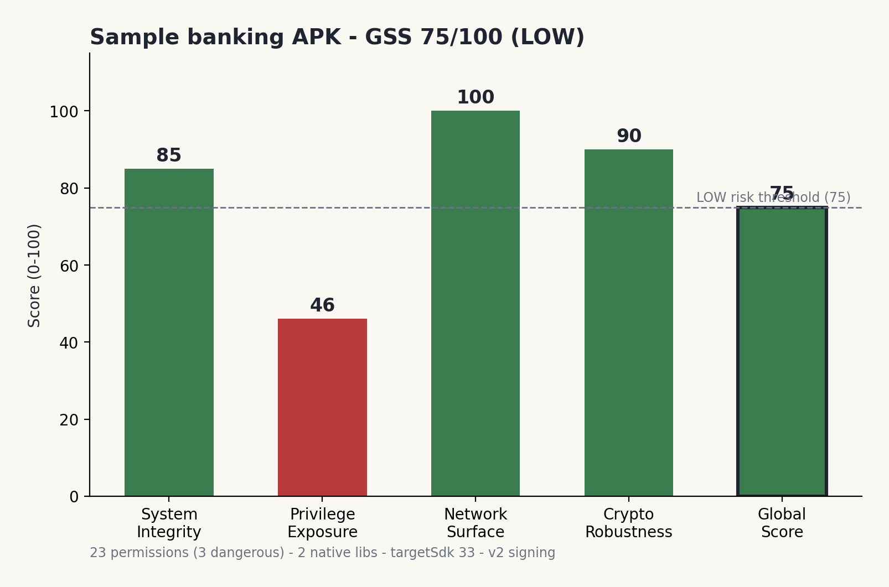

| Vector | Deductions | Score |
|---|---|---|
| System Integrity | native code -15 | 85 |
| Privilege Exposure | > 20 permissions -30, dangerous permissions -24 | 46 |
| Network Surface | none | 100 |
| Cryptographic Robustness | v2 signing -10 | 90 |
| **GSS** | 0.35*85 + 0.35*46 + 0.20*100 + 0.10*90 | **75 (LOW)** |

The low Privilege Exposure score (46) is what points the reviewer at the app's real weakness: SMS and location access that a banking app must justify.

## Standards mapping

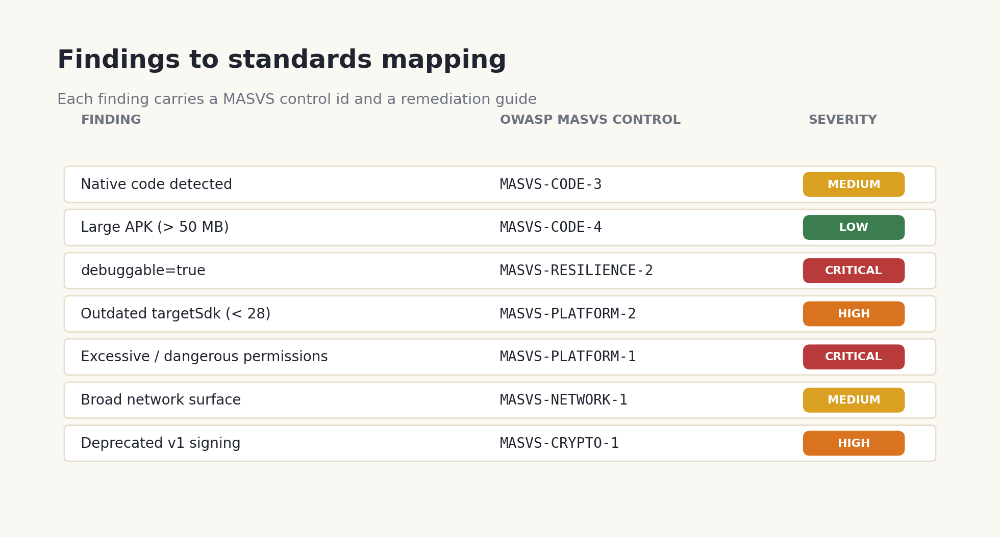

## Getting started

No build step and no dependencies.

```bash
git clone https://github.com/hafssa799/Cybersecurity-Portfolio.git
cd Cybersecurity-Portfolio/DIRS-Security-Suite/src
# open index.html in a modern browser (Chrome 90+, Firefox 88+, Edge 90+)
```

Then drag an `.apk` file into the **Audit Scanner** and click **Run Full Analysis**.

## Project structure

```
DIRS-Security-Suite/
├── README.md
├── LICENSE
├── src/                  # application code
│   ├── index.html
│   ├── style.css
│   ├── app.js            # controller
│   └── engine.js         # parsing + scoring engine
├── docs/
│   ├── DIRS-Security-Suite-Paper.pdf
│   └── DIRS-Presentation.pptx
├── screenshots/          # UI captures
└── diagrams/             # architecture and scoring diagrams
```

## Limitations

- **Static analysis only**: runtime behavior (dynamic code loading, C&C traffic, runtime permission requests) is not observed.
- **No bytecode decompilation**: `classes.dex` is not inspected.
- **Heuristic scoring**: the deductions and weights are an engineering model, not a malware detector. Adware with a small permission footprint can score well.
- **Preliminary validation**: the benchmark results in the paper are initial triage indicators, and the weights may need recalibration for specific app categories.

## Roadmap

- [ ] v1.1: live CVE enrichment through the NVD API
- [ ] v1.2: batch analysis of several APKs (ZIP upload)
- [ ] v2.0: dynamic analysis through a sandboxed emulator agent
- [ ] v2.1: on-device anomaly detection (ONNX Runtime Web)

## Documentation

- Paper: [`docs/DIRS-Security-Suite-Paper.pdf`](docs/DIRS-Security-Suite-Paper.pdf)
- Présentation complète : [Télécharger la présentation](https://github.com/hafssa799/Cybersecurity-Portfolio/raw/main/DIRS-Security-Suite/docs/DIRS-Presentation.pptx)
---
## License

Released under the MIT License, see [LICENSE](LICENSE).
