# 🏭 OT/ICS Security Lab — Détection et réponse automatisée (SOAR) sur GRFICSv3


Plateforme de cybersécurité pour systèmes industriels (OT/ICS) : déploiement d'un laboratoire **GRFICSv3** conteneurisé, simulation d'attaques sur le protocole **Modbus TCP** et sur l'interface **SCADA**, détection par **Suricata + Wazuh** et neutralisation automatique de l'attaquant par une boucle **SOAR** (Active Response + iptables).

> Projet réalisé dans le cadre d'un stage PFA (EMSI, année 2025-2026) au sein du service informatique du Groupe OCP, Khouribga.
> Tout a été réalisé dans un **laboratoire simulé et isolé** : aucune infrastructure de production n'a été touchée et aucune donnée réelle n'est publiée ici.

---

## 📌 Résumé

| | |
|---|---|
| **Objectif** | Reproduire un environnement industriel réaliste, l'attaquer de façon contrôlée, puis valider une chaîne de détection et de réponse automatisée |
| **Plateforme** | GRFICSv3 (procédé chimique Tennessee Eastman, PLC OpenPLC, HMI/SCADA ScadaLTS) |
| **Supervision** | Suricata (IDS réseau, ruleset Quickdraw Modbus + règles custom) · Wazuh (SIEM/XDR + Active Response) |
| **Attaques** | Reconnaissance Nmap · écriture Modbus non autorisée · flood Modbus · brute force Hydra sur l'HMI |
| **Référentiels** | MITRE ATT&CK for ICS · IEC 62443 · NIST SP 800-82 · modèle de Purdue |
| **Résultat clé** | Chaque attaque est détectée, puis l'IP de l'attaquant est bloquée automatiquement en **quelques secondes à moins d'une minute**, sans intervention humaine |

---

## 🧱 Architecture

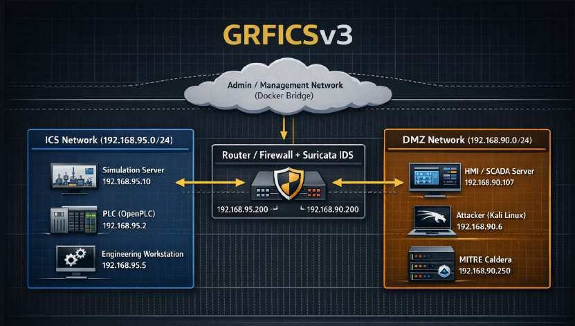

La plateforme est composée de deux réseaux Docker séparés par un conteneur **Router** qui porte la sonde Suricata. Tout flux entre l'attaquant et l'automate transite obligatoirement par ce point d'inspection.

| Composant | Rôle | Adresse IP | Zone | Niveau Purdue |
|---|---|---|---|---|
| Kali Linux | Poste attaquant | 192.168.90.6 | DMZ (192.168.90.0/24) | 4/5 (IT) |
| ScadaLTS | HMI / SCADA | 192.168.90.107 | DMZ | 3 |
| Router + Suricata | Pare-feu / IDS | 192.168.90.200 / 192.168.95.200 | DMZ ↔ ICS | 3.5 (DMZ industrielle) |
| OpenPLC | Automate (Modbus, port 502) | 192.168.95.2 | ICS (192.168.95.0/24) | 1 |
| Simulation Tennessee Eastman | Procédé physique | 192.168.95.10 | ICS | 0 |
| EWS | Station d'ingénierie | 192.168.95.5 | ICS | 2 |
| Wazuh Manager + agents | SIEM/XDR (agents : router, EWS, scadalts) | — | — | — |

**Chaîne de détection :** `Suricata → eve.json → agent Wazuh (router) → manager Wazuh → règles de corrélation → Active Response`

| Déploiement vérifié (`docker ps`) | Agents Wazuh actifs |
|---|---|
| 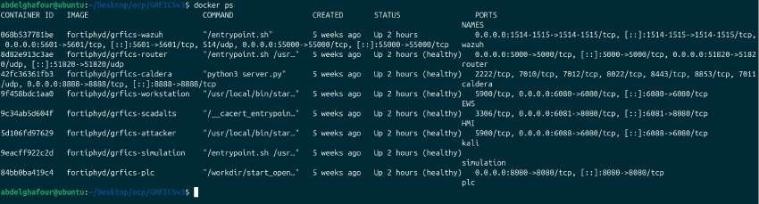 | 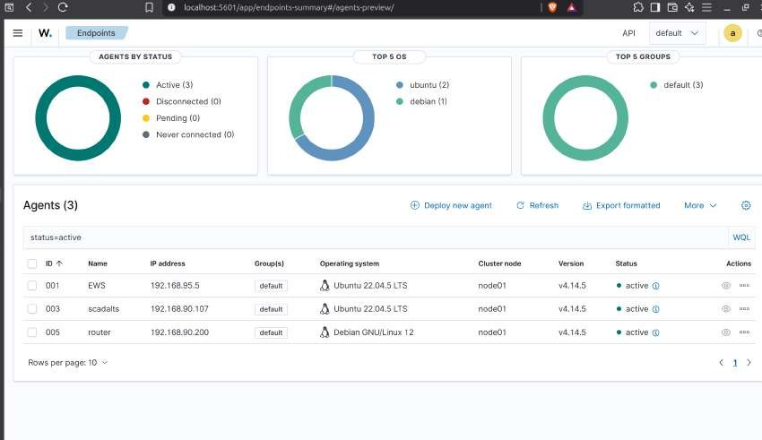 |

| PLC — OpenPLC (port 8080) | HMI — ScadaLTS |
|---|---|
| 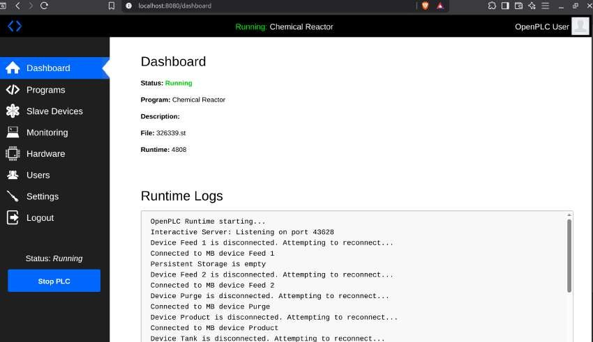 | 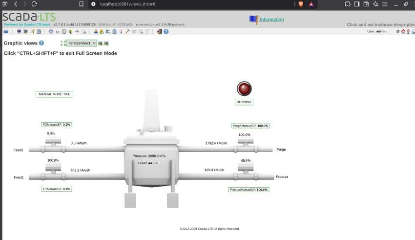 |

---

## ⚔️ Scénarios réalisés

| # | Scénario | Technique MITRE | Détection | Réponse automatisée |
|---|---|---|---|---|
| 1 | Reconnaissance réseau et découverte du service Modbus (Nmap) | — | Wazuh, règle 533 (agent EWS) | — |
| 2 | Écriture Modbus non autorisée sur le PLC | T0836 Modify Parameter · T0855 Unauthorized Command Message | Règle Suricata `9000001` → règle Wazuh `100200` (niveau 12) | `modbus-block.sh` + iptables DROP |
| 3 | Flood applicatif Modbus (300 requêtes) | T0814 Denial of Service | Signatures Suricata → règle Wazuh `86601`, seuil `100300` (5 alertes / 30 s) | Blocage iptables, maintenu 10 min |
| 4 | Brute force Hydra sur l'interface ScadaLTS | T1110 Brute Force · T1078.001 Default Accounts | Règles Wazuh `100100` (niveau 5) et `100101` (niveau 10, 8 tentatives / 60 s) | `firewall-drop`, blocage 600 s |

### Scénario 1 — Reconnaissance

Scan depuis Kali (`nmap -sn`, `-sS`, `-sV`, `-Pn`) : le port **502/tcp (Modbus)** est découvert sur le PLC.
Constat intéressant : le laboratoire ne contenait pas les règles de reconnaissance génériques (Emerging Threats), donc **Suricata n'a rien vu**. C'est la **détection basée sur l'hôte** (agent Wazuh sur l'EWS, règle 533 « Listened ports status changed ») qui a levé l'alerte : une illustration concrète de la défense en profondeur.

| Scan Nmap depuis Kali | Détection par l'agent Wazuh |
|---|---|
| 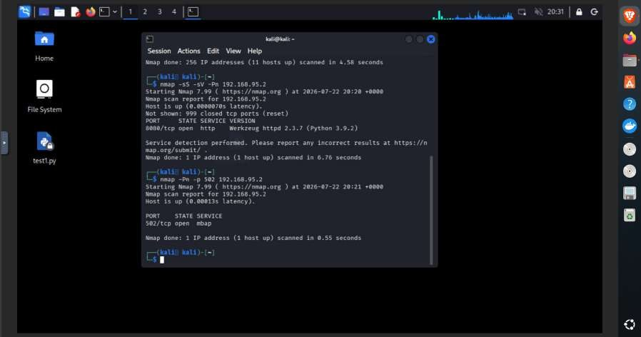 | 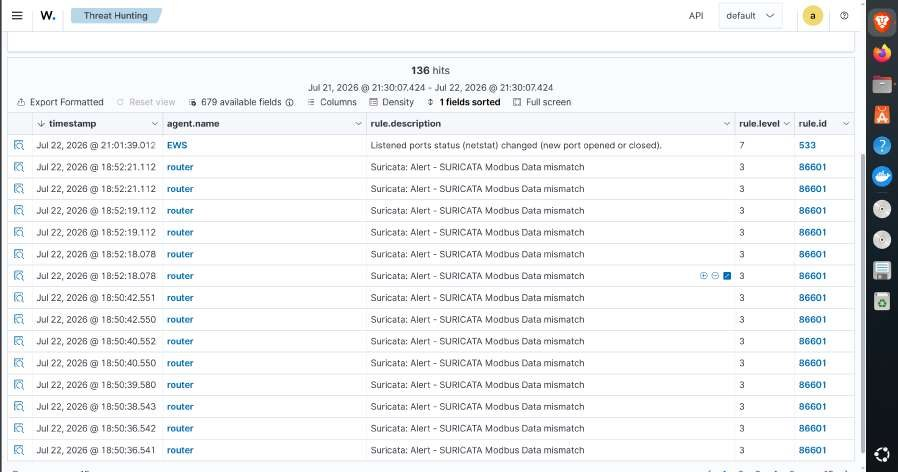 |

### Scénario 2 — Écriture Modbus non autorisée

Les registres 10 à 15 de l'automate ont été corrélés avec l'HMI. Une seule écriture **Write Single Register (FC6)** sur le registre 11 (valeur 30000) modifie la consigne de la vanne **Feed2 de 0 % à 45,8 %** et perturbe l'équilibre du procédé. La valeur a été choisie volontairement non maximale pour éviter l'arrêt de sécurité de la simulation (au-delà d'environ 3000 kPa).

| Écriture Modbus depuis Kali | Effet sur l'HMI (Feed2 = 45,8 %) |
|---|---|
| 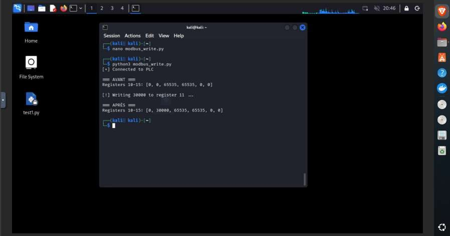 | 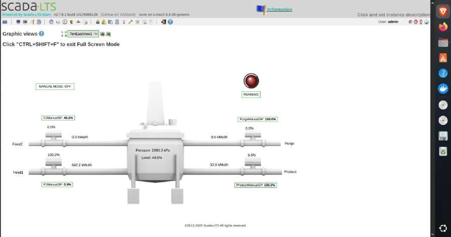 |

**Détection.** Les règles ICS par défaut de Suricata ne détectent que des anomalies de protocole : une écriture valide mais illégitime passe inaperçue. Une règle personnalisée comble ce manque ([`rules/suricata/local.rules`](rules/suricata/local.rules)) :

```
alert modbus any any -> 192.168.95.2 502 (msg:"SCADA_IDS: Unauthorized Modbus Write Detected"; modbus: access write; sid:9000001; rev:1;)
```

**Problème rencontré :** après création de la règle, aucune alerte. Le diagnostic a montré que la sonde Suricata était lancée sur l'interface d'administration (`-i eth2`) et ne voyait jamais le trafic de Kali, qui entre par `eth1` (DMZ). Après correction de l'interface d'écoute, l'alerte remonte jusqu'au dashboard Wazuh.

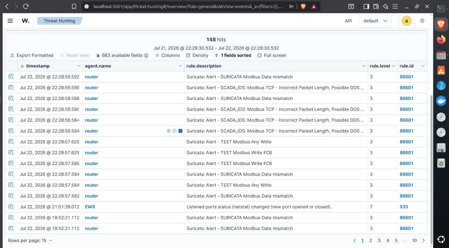

**Réponse automatisée (SOAR).**

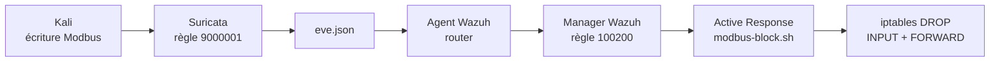

- Règle de corrélation : [`rules/wazuh/local_rules.xml`](rules/wazuh/local_rules.xml)
- Script de blocage : [`active-response/modbus-block.sh`](active-response/modbus-block.sh)
- Déclaration dans Wazuh : [`config/ossec-active-response-scenario2.xml`](config/ossec-active-response-scenario2.xml)

| Blocage en temps réel : l'écriture passe, la lecture suivante échoue | Règles iptables DROP ajoutées automatiquement |
|---|---|
| 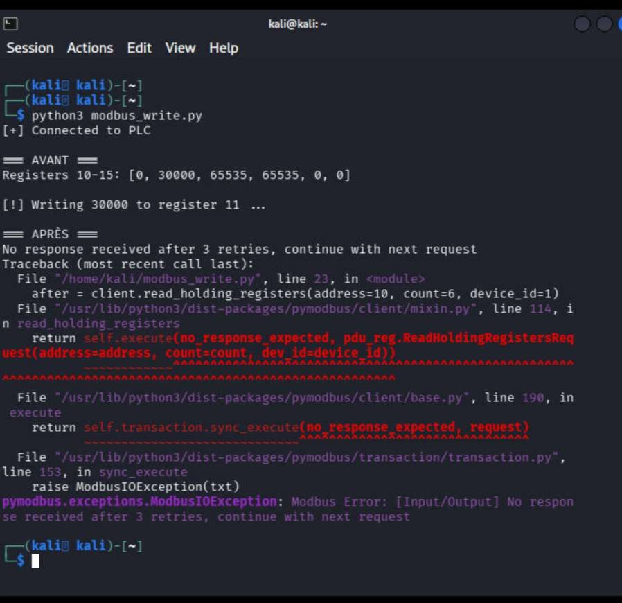 | 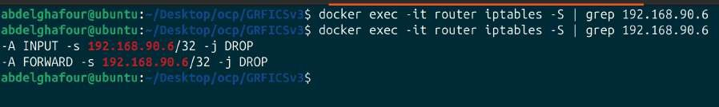 |

Nouvelle tentative : la connexion expire dès le départ. **L'attaque n'est plus seulement détectée, elle est empêchée.**

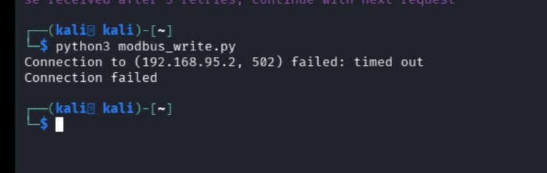

### Scénario 3 — Flood applicatif Modbus

Script [`scripts/modbus_flood.py`](scripts/modbus_flood.py) : 300 requêtes *Read Holding Registers* (FC3) consécutives depuis Kali vers le PLC. Une fonction de lecture valide a été choisie volontairement, car elle est plus difficile à filtrer qu'une trame invalide : le caractère malveillant vient de la répétition.

Le PLC a répondu à 300 requêtes sur 300, sans erreur applicative. Ce résultat **ne prouve donc pas à lui seul un déni de service** : la preuve est cherchée côté détection réseau.

| Exécution du flood (300/300 requêtes) | Alertes Suricata quantifiées |
|---|---|
| 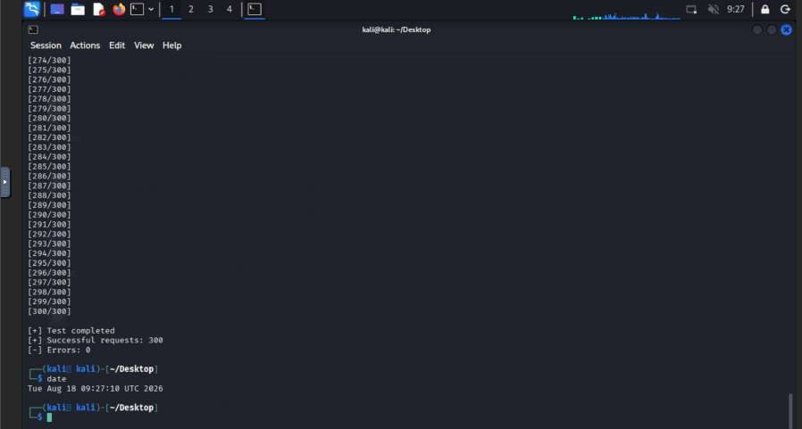 | 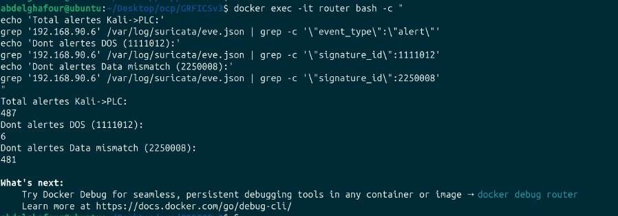 |

- **487 alertes Suricata** générées : 481 × *Modbus Data mismatch* (SID 2250008) et 6 × *Incorrect Packet Length, Possible DOS Attack* (SID 1111012).
- Toutes décodées par Wazuh via la règle parente `86601`. Le dashboard cumule **7 236 occurrences** (rejeux successifs inclus).
- **Réponse SOAR :** la règle `100300` ne se déclenche qu'après 5 alertes d'une même IP en moins de 30 s (pour éviter les faux positifs). Le script `modbus-dos-block.sh` applique alors des règles iptables DROP, maintenues 10 minutes : l'attaquant est banni dès sa 5ᵉ requête.

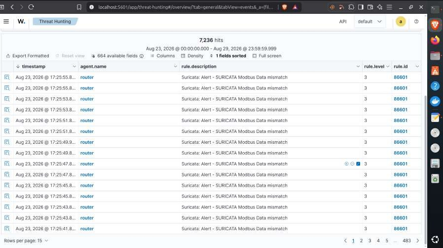

**Incidents résolus pendant la mise en place** : sonde Suricata non démarrée, bruit de fond (filtrage sur l'IP de l'attaquant), corruption de `eve.json` par une instance Suricata redondante, désynchronisation de l'affichage Wazuh (offset de l'indexeur). Leçon : la détection fonctionnait depuis le début, c'est l'indexation en aval qui masquait les alertes.

### Scénario 4 — Brute force sur l'interface ScadaLTS

Attaque **Hydra** (25 combinaisons, 1 thread) contre le formulaire `/login.htm`. Le compte par défaut **`admin/admin`** est actif : le credential n'a jamais été modifié après le déploiement.

- **80 % de faux positifs** côté Hydra : sur 5 couples annoncés valides, seul `admin/admin` fonctionne réellement (validation croisée indépendante en Python, via les en-têtes de redirection HTTP).
- **Angle mort de détection :** aucune alerte Wazuh au départ. Les logs Tomcat étaient collectés, mais aucune règle ne les corrélait.
- **Correction :** deux règles personnalisées, `100100` (niveau 5, chaque tentative de login) et `100101` (niveau 10, 8 tentatives en 60 s depuis la même IP = brute force, MITRE T1110), validées avec `wazuh-logtest`.
- **SOAR :** Active Response avec le script natif `firewall-drop` ([`config/ossec-active-response-scenario4.xml`](config/ossec-active-response-scenario4.xml)), blocage iptables pendant 600 s.

| Sortie brute d'Hydra | Validation croisée (faux positifs) |
|---|---|
| 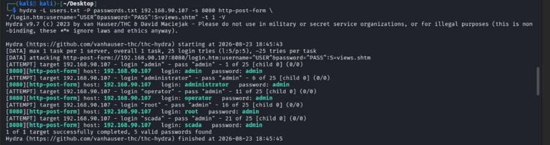 | 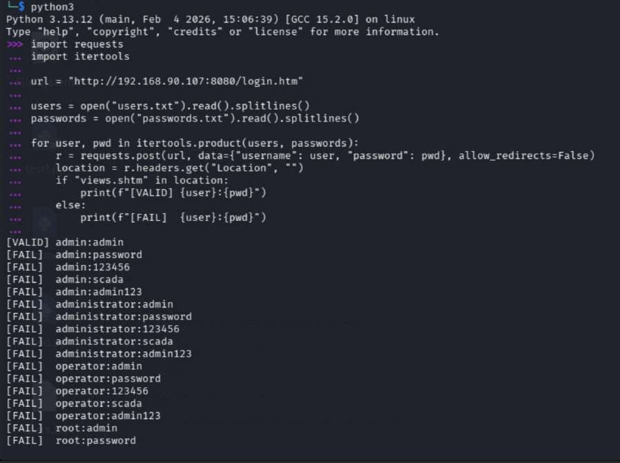 |

| Alertes Wazuh `100100` / `100101` | Règles DROP sur l'agent ScadaLTS | Accès bloqué côté attaquant |
|---|---|---|
| 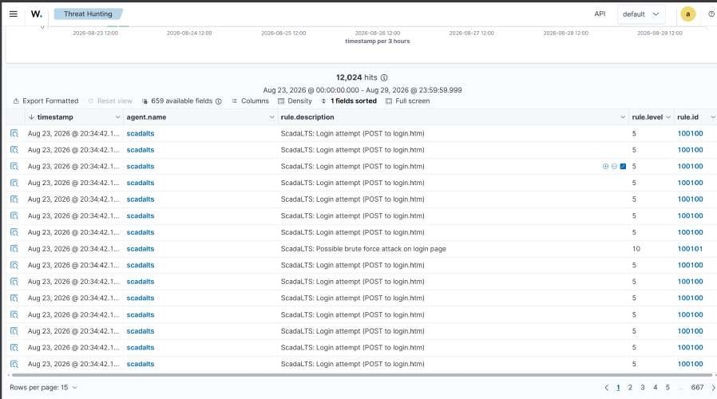 | 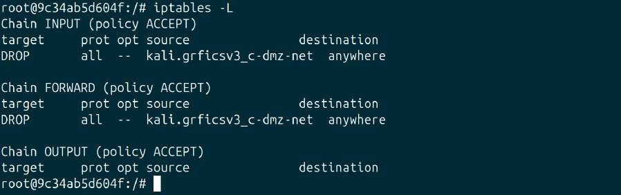 | 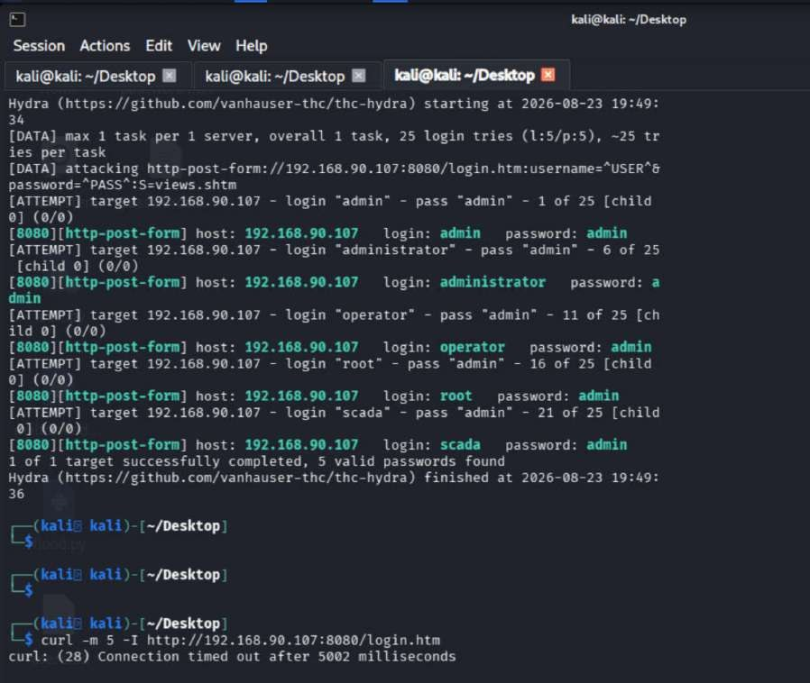 |

---

## 📊 Résultats et enseignements

- La chaîne **détection → corrélation → blocage** est validée de bout en bout sur 3 attaques (Modbus write, DoS Modbus, brute force web), avec un blocage réversible (déblocage automatique après 600 s).
- Les règles par défaut de Suricata et Wazuh laissent des **angles morts** : écritures Modbus valides mais illégitimes, et couche applicative web des IHM. Des règles personnalisées sont indispensables.
- **Une supervision hybride IT/OT** est nécessaire : l'interface web d'administration et les identifiants par défaut constituent un vecteur d'entrée à part entière.
- Il faut **vérifier chaque maillon** de la chaîne avant de conclure à l'absence de détection, et **valider les résultats des outils automatiques** (Hydra : 80 % de faux positifs).
- Volume d'événements important (plus de 12 000 alertes sur le scénario 4) : risque d'**alert fatigue** à traiter en production.

## ⚠️ Limites et perspectives

**Limites :** environnement simulé (OpenPLC en conteneur ≠ automate physique), topologie simplifiée (2 segments, 1 routeur), seuls Modbus TCP et l'interface HTTP de ScadaLTS sont couverts, détection basée sur des signatures statiques (aveugle aux attaques *low-and-slow*).

**Perspectives :** étendre la détection à DNP3, IEC 61850, EtherNet/IP et OPC-UA · détection comportementale / UEBA · enrichir le SOAR (notifications, collecte forensique, ticketing) · hardening (Modbus Security, verrouillage de comptes, suppression des mots de passe par défaut) selon IEC 62443 et NIST SP 800-82.

---

## 🚀 Reproduire le laboratoire

**Prérequis :** machine Linux, Docker Engine + Docker Compose v2, 8 Go de RAM minimum (16 Go recommandés avec Wazuh), 30 Go de disque.

```bash
sudo apt install -y git git-lfs
git clone https://github.com/Fortiphyd/GRFICSv3.git
cd GRFICSv3
./build.sh
docker ps    # vérifier que tous les conteneurs sont "Up"
```

Ensuite : déployer Wazuh (manager + agents sur `router`, `ews`, `scadalts`), faire écouter Suricata sur l'interface côté DMZ du routeur, puis appliquer les fichiers de ce dépôt :

| Fichier | À déployer sur |
|---|---|
| [`rules/suricata/local.rules`](rules/suricata/local.rules) | Router (Suricata) |
| [`rules/wazuh/local_rules.xml`](rules/wazuh/local_rules.xml) | Manager Wazuh (`/var/ossec/etc/rules/`) |
| [`active-response/modbus-block.sh`](active-response/modbus-block.sh) | Router (`/var/ossec/active-response/bin/`) |
| [`config/`](config) | Manager Wazuh (`ossec.conf`) |
| [`scripts/modbus_flood.py`](scripts/modbus_flood.py) | Kali (`pip install pymodbus`) |

## 📁 Structure du dépôt

```
OT-ICS-Security-Lab/
├── README.md
├── images/              # captures d'écran du laboratoire
├── rules/
│   ├── suricata/        # règle de détection d'écriture Modbus
│   └── wazuh/           # règle de corrélation 100200
├── active-response/     # script de blocage iptables
├── config/              # blocs ossec.conf (scénarios 2 et 4)
└── scripts/             # script de flood Modbus (laboratoire uniquement)
```

## ⚖️ Avertissement

Les scripts d'attaque sont fournis à titre **pédagogique, uniquement pour le laboratoire GRFICSv3 isolé** décrit ici. Ne jamais les utiliser contre des systèmes pour lesquels vous n'avez pas d'autorisation écrite.

## 🛠️ Technologies

GRFICSv3 · OpenPLC · ScadaLTS · Docker / Docker Compose · Suricata · Wazuh · Kali Linux · Nmap · Wireshark · Hydra · Python (pymodbus) · iptables · VMware Workstation · Ubuntu

## 👥 Auteurs

Projet réalisé par **Hafssa Azarg** et **Abdelghafour Ennoukra** (EMSI Marrakech, 2025-2026).

## 📚 Références

[GRFICSv3](https://github.com/Fortiphyd/GRFICSv3) · [OpenPLC](https://github.com/thiagoralves/OpenPLC_v3) · [ScadaLTS](https://github.com/SCADA-LTS/Scada-LTS) · [Wazuh](https://documentation.wazuh.com) · [Suricata](https://docs.suricata.io) · [MITRE ATT&CK for ICS](https://attack.mitre.org/matrices/ics/) · IEC 62443 · NIST SP 800-82
